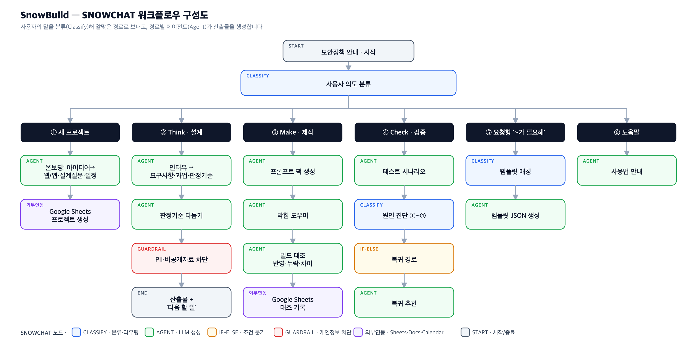

# Snowchat — SnowBuild

2026 SNOWCHAT AI 서비스 경진대회 출품작 **SnowBuild** 관련 문서.

> 아이디어를 '작동하는 디지털 제품'으로 완성시키는 SNOWCHAT 메이커 에이전트

## 문서
- [기획안_SnowBuild.md](기획안_SnowBuild.md) — 공모전 제출용 서비스 기획안 (7개 항목)
- [PRD.md](PRD.md) — 제품 요구사항 문서 (Cobuild 원본 기획)

## 워크플로우 구성도
사용자의 말을 분류(Classify)해 알맞은 경로로 보내고, 경로별 에이전트(Agent)가 산출물을 생성합니다.

